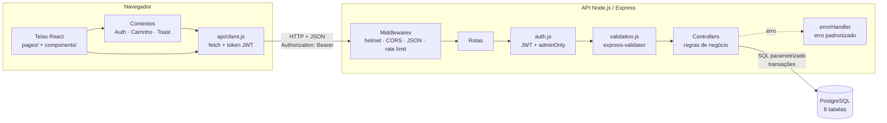
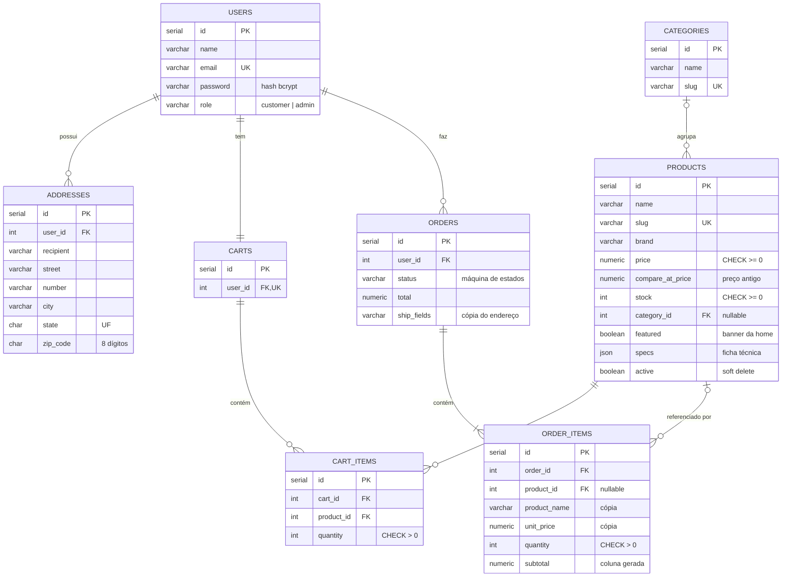
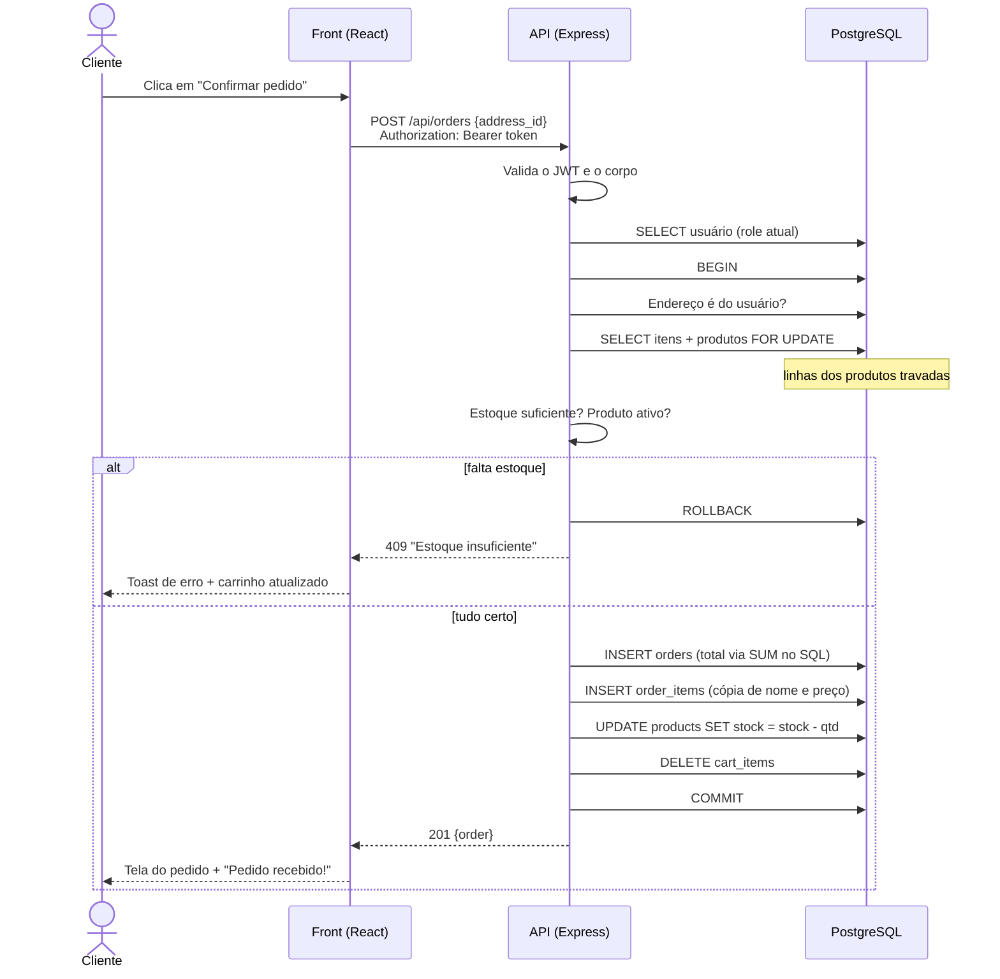

# Material da apresentação — GamerZone Store

Este documento reúne o que a equipe precisa para apresentar o sistema: arquitetura, diagramas, fluxos, roteiro de demonstração, perguntas prováveis do professor com respostas e a divisão dos tópicos. Os diagramas usam Mermaid e aparecem desenhados direto no GitHub.

---

## 1. Arquitetura

O sistema segue uma **arquitetura cliente-servidor em três camadas**. O front-end React roda no navegador e conversa com a API REST por HTTP/JSON. A API concentra todas as regras de negócio e é a única que acessa o PostgreSQL.

**Organização do back-end, em camadas:**

| Camada | Responsabilidade | Exemplo |
|---|---|---|
| Rotas (`routes/`) | Mapear URL e método para a função certa e encadear middlewares | `router.post('/', authMiddleware, v.create, createOrder)` |
| Middlewares (`middleware/`) | Autenticar, autorizar, validar e tratar erros, de forma reutilizável | `adminOnly` em toda rota administrativa |
| Controllers (`controllers/`) | Regras de negócio e acesso ao banco | O checkout transacional |
| Banco (`db/`) | Conexão, transações, migrações e seed | `withTransaction(fn)` |

**Organização do front-end:** a loja tem vitrine (`Home`), catálogo com filtros (`Shop`), produto, favoritos, carrinho, checkout, pedidos e painel admin. As telas (`pages/`) nunca chamam `fetch` diretamente. Elas usam `api/services.js`, que passa por `api/client.js`. Esse arquivo é o único lugar que conhece a URL da API, injeta o token e converte erros. Estado global (usuário logado, carrinho, favoritos, notificações e o diálogo de confirmação) fica em Contexts do React. A interface usa animações curtas (150 a 300 ms) para dar retorno às ações, como o botão "Adicionado", o contador do carrinho, as etapas da compra e a linha do tempo do pedido. Todas são desligadas automaticamente quando o sistema pede movimento reduzido.

---

## 2. Diagrama entidade-relacionamento

**Cardinalidades:**

| Relacionamento | Cardinalidade | Como é garantido |
|---|---|---|
| Usuário → Endereços | 1 : N | FK `addresses.user_id`, `ON DELETE CASCADE` |
| Usuário → Carrinho | 1 : 1 | `carts.user_id` é `UNIQUE` |
| Carrinho → Itens | 1 : N | FK + `UNIQUE(cart_id, product_id)`: o mesmo produto aparece uma vez |
| Categoria → Produtos | 1 : N (opcional) | FK `ON DELETE SET NULL` |
| Usuário → Pedidos | 1 : N | FK `orders.user_id` |
| Pedido → Itens | 1 : N (mínimo 1) | FK `ON DELETE CASCADE`; o checkout recusa carrinho vazio |

**Regras de integridade no próprio banco** (valem mesmo se a API tiver um bug): `CHECK (price >= 0)`, `CHECK (stock >= 0)`, `CHECK (quantity > 0)`, `CHECK` da lista de status e de papéis, regex de CEP, e-mail e slugs `UNIQUE`.

**Estratégia de preço no momento da compra:** `order_items` guarda uma **cópia** de `product_name` e `unit_price`, e `orders` guarda uma cópia do endereço. Se o produto mudar de preço, for renomeado ou desativado, ou se o cliente apagar o endereço, o pedido antigo continua exatamente como foi feito. O `subtotal` é uma coluna gerada pelo banco (`unit_price * quantity`), então não há como ficar inconsistente.

---

## 3. Fluxo entre front-end, API e banco (checkout)

---

## 4. Principais rotas

| Recurso | Rotas | Quem acessa |
|---|---|---|
| Autenticação | `POST /auth/register`, `POST /auth/login`, `GET /auth/me` | Público / logado |
| Produtos | `GET /products` (busca, departamento, marca, preço, ofertas, destaques, ordenação), `GET /products/:id` | Público |
| Vitrine | `GET /products/best-sellers`, `GET /products/:id/related`, `GET /products/brands` | Público |
| Produtos (gestão) | `POST`, `PUT`, `DELETE /products`, `GET /products/admin/all` | Admin |
| Categorias | `GET /categories`; `POST`, `PUT`, `DELETE` | Público / admin |
| Carrinho | `GET /cart`, `POST /cart/items`, `PATCH`/`DELETE /cart/items/:id`, `DELETE /cart` | Logado |
| Endereços | `GET`, `POST /addresses`, `DELETE /addresses/:id` | Logado (só os próprios) |
| Pedidos | `POST /orders`, `GET /orders`, `GET /orders/:id`, `PATCH /orders/:id/cancel` | Logado (só os próprios) |
| Pedidos (gestão) | `GET /orders/admin/all`, `PATCH /orders/:id/status` | Admin |

Detalhes e exemplos em [API.md](API.md).

---

## 5. Fluxos explicados

### Cadastro
1. O formulário confere no navegador se as duas senhas são iguais (conforto para o usuário).
2. A API valida nome, e-mail e senha com `express-validator`. Se algo falhar, retorna 400 com o campo exato, e o front mostra o erro embaixo do campo.
3. A senha vira hash com **bcrypt** (custo 10, com salt automático). A senha original nunca é gravada.
4. O `INSERT ... ON CONFLICT (email) DO NOTHING` evita duplicidade mesmo com dois cadastros simultâneos. Se o e-mail já existe, retorna 409.
5. A conta nasce sempre como `customer`, mesmo se alguém mandar `"role": "admin"` no corpo.
6. A API devolve um token JWT, e o usuário já entra logado.

### Login
1. A API busca o usuário pelo e-mail e compara a senha com `bcrypt.compare`.
2. E-mail inexistente e senha errada recebem **a mesma mensagem**, e o tempo de resposta é parecido (compara com um hash falso), para não revelar quais e-mails estão cadastrados.
3. O token JWT (HS256, validade de 1 dia) carrega só o id do usuário.
4. O front guarda o token e o envia em `Authorization: Bearer`. A cada requisição protegida, a API valida a assinatura e **busca o usuário no banco**. Assim, uma mudança de papel ou exclusão vale na hora.
5. Há limite de 20 tentativas por IP a cada 15 minutos.

### Carrinho
1. O carrinho fica **no banco**, não no navegador. Por isso persiste entre dispositivos e reinícios, e os preços nunca vêm do cliente.
2. Adicionar um produto que já está no carrinho soma a quantidade, e a soma é limitada ao estoque.
3. Totais e subtotais são calculados em SQL (`SUM(price * quantity)`) com `NUMERIC`, sem erro de arredondamento do JavaScript.
4. O front mantém o carrinho num Context: o contador no cabeçalho atualiza em todas as telas.

### Vitrine (página inicial)
1. O banner mostra os produtos com `featured = true`, escolhidos pelo admin.
2. "Ofertas da semana" usa `on_sale=true&sort=discount`: o banco calcula o percentual de desconto a partir do preço antigo.
3. "Mais vendidos" soma, em SQL, as unidades de `order_items` dos pedidos que não foram cancelados. Ou seja, muda de verdade quando alguém compra.
4. A página do produto traz a ficha técnica (campo `specs`) e produtos relacionados da mesma categoria.

### Pedido
1. No checkout, o cliente escolhe ou cadastra um endereço.
2. A API executa tudo numa transação, travando os produtos com `FOR UPDATE` (ver o diagrama da seção 3).
3. O pedido começa como `pending`. O pagamento é simulado.
4. O cliente pode cancelar enquanto o pedido está `pending`, e o estoque volta.
5. O admin avança o status pelo painel, respeitando a máquina de estados (`pending → processing → shipped → delivered`; cancelamento até `processing`).

---

## 6. Justificativa das tecnologias

| Escolha | Por quê | Alternativa considerada |
|---|---|---|
| **Node.js + Express** | Já era a base do projeto; é simples, muito documentado e usa JavaScript tanto no front quanto no back | NestJS: estrutura mais pesada do que o escopo pede |
| **PostgreSQL** | Relacional com transações ACID, `CHECK`, FKs, `FOR UPDATE` e colunas geradas, essenciais para estoque e dinheiro | MongoDB: perderíamos integridade referencial e transações simples |
| **SQL puro com `pg`** | A equipe enxerga e explica cada query; queries parametrizadas eliminam SQL injection | Prisma/Sequelize: mais uma camada para aprender e explicar |
| **Migrações próprias (SQL)** | Cerca de 70 linhas, versionadas no Git, cada arquivo aplicado uma vez | Knex migrations: dependência extra para pouca coisa |
| **JWT** | Stateless, padrão em APIs REST, fácil de testar com Postman e Supertest | Sessão com cookie: exigiria store de sessão e proteção CSRF |
| **bcrypt** | Algoritmo feito para senhas (lento de propósito, com salt) | SHA-256: rápido demais, vulnerável a força bruta |
| **express-validator** | Validação declarativa por rota, com mensagens por campo | Joi/Zod: equivalentes, mas o projeto já usava este |
| **helmet + rate limit + CORS restrito** | Proteções básicas de mercado com uma linha cada | — |
| **React + Vite** | Já previsto na divisão da equipe; o Vite inicia em milissegundos e gera build otimizado | Next.js: SSR desnecessário aqui |
| **Jest + Supertest** | Testam a API de verdade (HTTP → Express → PostgreSQL) sem abrir porta | Postman/Newman: menos flexível para preparar o banco |

---

## 7. Roteiro de demonstração (cerca de 12 minutos)

**Antes de começar:** rode `npm run db:reset` no `backend/` para começar limpo. Deixe abertos o terminal do back, o do front, o navegador em `http://localhost:5173` e uma aba anônima.

| # | Quem | O que mostrar | O que falar |
|---|---|---|---|
| 1 | Luiz | Rodar `npm test` no back-end | "72 testes automáticos cobrindo os 12 cenários pedidos, contra um PostgreSQL real, passando." |
| 2 | Luis | Home: banner de destaques, ofertas com % de desconto, departamentos. Depois buscar "mouse" no cabeçalho e, no catálogo, filtrar por marca, preço e "somente ofertas" | "Tudo vem da API; os filtros ficam na URL." |
| 3 | Luis | Abrir um produto e clicar "Adicionar" sem estar logado | "Sem login, o site manda para a tela de entrada e volta para o produto depois." |
| 4 | Luis | Criar uma conta nova. Antes, tentar com a senha `123` | Mostrar o erro apontado no campo pela API. |
| 5 | Luis | Adicionar 2 produtos; no carrinho, alterar a quantidade e remover um | "O total é calculado no servidor; mesmo se eu alterar o preço no navegador, não muda nada." |
| 6 | Luiz | Tentar adicionar mais unidades da Estátua do que o estoque (4) | Erro 409 "Estoque insuficiente". |
| 7 | Luis | Checkout: cadastrar endereço e confirmar. Voltar à home | Pedido criado, carrinho zerado, e o produto comprado sobe em "Mais vendidos". |
| 8 | Hugo | No `psql`: `SELECT * FROM order_items;` e `SELECT stock FROM products WHERE id = ...;` | Mostrar a cópia do preço e a baixa de estoque. |
| 9 | Hugo | `UPDATE products SET price = 1 WHERE id = ...;` e recarregar o pedido | "O pedido continua com o preço da compra: é o snapshot." |
| 10 | Luiz | Entrar como admin: criar produto com marca, preço antigo, destaque e ficha técnica; desativar outro; avançar o status do pedido | Tentar `delivered` direto mostra o bloqueio da máquina de estados. |
| 11 | Hugo | Na aba anônima, logado como `cliente@`, abrir `/pedidos/<id do pedido da outra conta>` | "Pedido não encontrado": um usuário não vê dados de outro. |
| 12 | Hugo | Parar o back (Ctrl+C), subir de novo e recarregar o site | Carrinho e pedidos continuam: persistência. |

Plano B: se a rede falhar, nada depende de internet. Fontes e ilustrações vêm empacotadas no projeto.

---

## 8. Perguntas que o professor pode fazer

**Por que o carrinho fica no banco e não no `localStorage`?**
Para que o servidor seja a única fonte de verdade de preço e estoque, o carrinho funcione em qualquer dispositivo e seja testável pela API. A desvantagem é exigir login para montar o carrinho, o que aceitamos para o escopo.

**Como vocês evitam vender o mesmo item duas vezes?**
No checkout, `SELECT ... FOR UPDATE` trava as linhas dos produtos dentro da transação. Uma segunda compra simultânea espera a primeira terminar e já enxerga o estoque atualizado. Como segunda barreira, o banco tem `CHECK (stock >= 0)`. Há um teste que força essa corrida, e confirmamos que ele falha se removermos o `FOR UPDATE`.

**O que é uma transação e por que vocês usam?**
É um bloco de operações que acontece por inteiro ou não acontece (atomicidade, o "A" de ACID). No checkout são 5 escritas (pedido, itens, estoque, carrinho). Se uma falhar no meio, o `ROLLBACK` desfaz tudo e não fica pedido sem itens nem estoque baixado sem pedido.

**Por que copiar nome e preço para `order_items` se já existe `product_id`?**
Porque o pedido é um registro histórico. Preço e nome mudam com o tempo, e produtos podem ser desativados. Sem a cópia, um pedido antigo mostraria o preço de hoje. É a mesma lógica de uma nota fiscal.

**Como vocês protegem contra SQL injection?**
Todas as queries usam parâmetros (`$1`, `$2`). O driver envia os valores separados do comando, então o texto do usuário nunca vira SQL. Onde o SQL é montado dinamicamente (filtros e ordenação), os nomes de colunas vêm de listas fixas no código. Há teste enviando `' OR 1=1; DROP TABLE products; --` na busca.

**Por que bcrypt e não SHA-256?**
SHA-256 é rápido, e com uma GPU dá para testar bilhões de senhas por segundo. O bcrypt é lento de propósito (custo configurável) e usa salt único por senha, o que impede tabelas pré-calculadas.

**Onde fica o token e quais os riscos?**
No `localStorage`. É simples, mas um ataque XSS conseguiria lê-lo. Reduzimos esse risco com React (escapa o HTML por padrão), validação de `image_url` (só http/https) e `helmet`. Em produção, a alternativa seria cookie `HttpOnly` + `SameSite`, com proteção CSRF.

**Se o admin for rebaixado, o token dele continua valendo como admin?**
Não. O token guarda só o id; o papel é lido do banco a cada requisição. Há teste para isso.

**Por que um pedido de outro usuário retorna 404 e não 403?**
O 403 confirmaria que o pedido existe. Com 404, não se revela nada, o que dificulta a enumeração de IDs (falha do tipo IDOR, do OWASP Top 10).

**Como garantem que o total está certo?**
O cálculo é feito no PostgreSQL com `NUMERIC` (decimal exato), não com `float` do JavaScript, em que `0.1 + 0.2 = 0.30000000000000004`. Há teste exatamente com esses valores. O preço enviado pelo cliente é ignorado.

**Por que "excluir produto" só desativa?**
Pedidos antigos referenciam o produto. A exclusão lógica (`active = false`) tira o produto da loja e dos carrinhos sem quebrar o histórico.

**Como funcionam as migrações?**
Cada mudança de estrutura é um arquivo `.sql` numerado. O script registra em `schema_migrations` os arquivos já aplicados e roda só os novos, cada um numa transação. Para evoluir o banco, cria-se `002_...sql`, sem editar o 001.

**Como os testes não estragam o banco de desenvolvimento?**
Rodam num banco separado (`gamerzone_test`), recriado no início, e cada teste recarrega os dados de demonstração para começar sempre do mesmo estado.

**De onde vêm as imagens dos produtos?**
São ilustrações vetoriais (SVG) geradas por um script Python do próprio projeto (`frontend/scripts/gerar_ilustracoes.py`). Escolhemos isso porque fotos de produtos de marcas reais têm direito autoral, e porque a apresentação não pode depender de internet. O admin pode trocar por uma URL `https://`, e o servidor valida o endereço para bloquear `javascript:` (XSS).

**Por que a ficha técnica é uma coluna JSON e não uma tabela?**
Cada tipo de produto tem atributos diferentes (DPI para mouse, resolução para monitor), e nós só exibimos a ficha, sem filtrar por esses campos. Uma coluna `JSON` com `CHECK (json_typeof(specs) = 'object')` resolve sem criar tabelas para cada tipo. Usamos `JSON` e não `JSONB` porque o `JSONB` reordena as chaves, e a ficha sairia fora da ordem cadastrada. Se fosse preciso filtrar por atributo, o caminho seria uma tabela `product_attributes` ou `JSONB` com índice GIN.

**Como vocês evoluíram o banco sem perder dados?**
Com a migração `002_vitrine.sql`, que só adiciona colunas (`ALTER TABLE ... ADD COLUMN`). Quem já tinha o banco roda `npm run db:setup`: o runner aplica só a 002, e o seed completa os produtos antigos sem sobrescrever o que o admin editou.

**O que faltaria para colocar em produção?**
Gateway de pagamento real, HTTPS, cálculo de frete, upload de imagens em storage, recuperação de senha por e-mail, logs estruturados e monitoramento, rate limit compartilhado (Redis) e testes automatizados de interface (Playwright).

---

## 9. Sugestão de divisão dos tópicos

| Integrante | Tópicos na fala | Parte da demonstração |
|---|---|---|
| **Luiz** (líder, back-end) | Abertura e objetivo; arquitetura (seção 1); rotas e camadas da API; autenticação JWT e autorização; máquina de estados do pedido | Passos 1, 6 e 10 |
| **Luis** (front-end) | Estrutura do React (páginas, contexts, cliente HTTP único); estados de carregando, erro e vazio; integração e CORS; experiência de compra | Passos 2 a 5 e 7 |
| **Hugo** (banco, testes e documentação) | Modelo ER e cardinalidades (seção 2); snapshot de preço; transação e `FOR UPDATE`; segurança (SQL injection, bcrypt, IDOR); estratégia de testes e resultado | Passos 8, 9, 11 e 12 |

Perguntas do professor: cada um responde as da própria área. As de banco, concorrência e segurança ficam com Hugo, as de API e arquitetura com Luiz, e as de interface com Luis.
